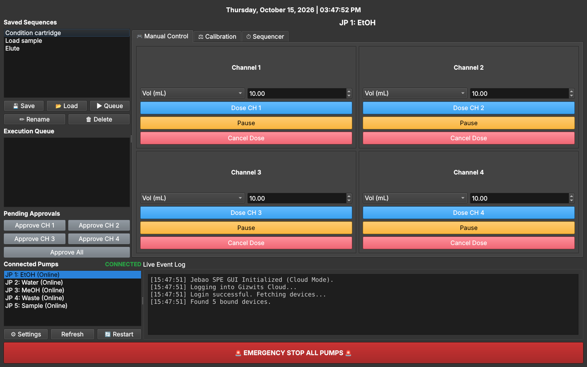
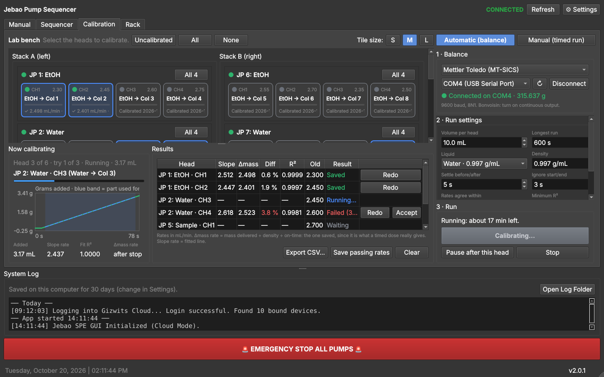
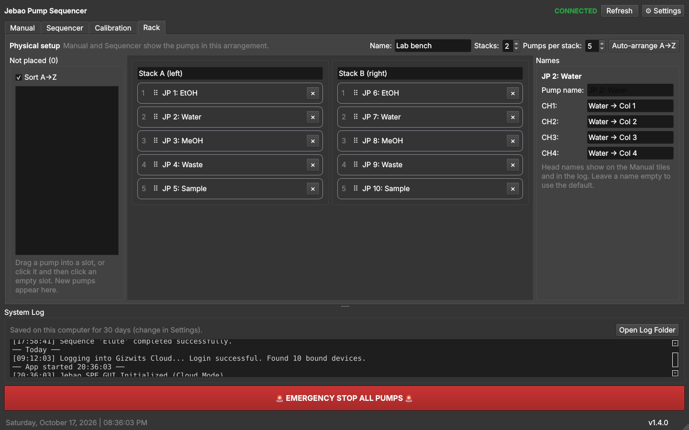
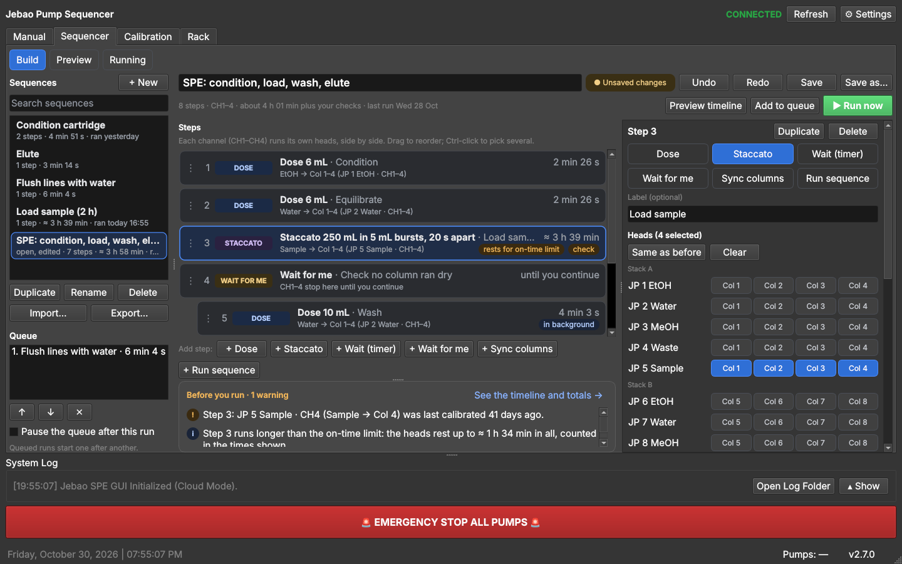
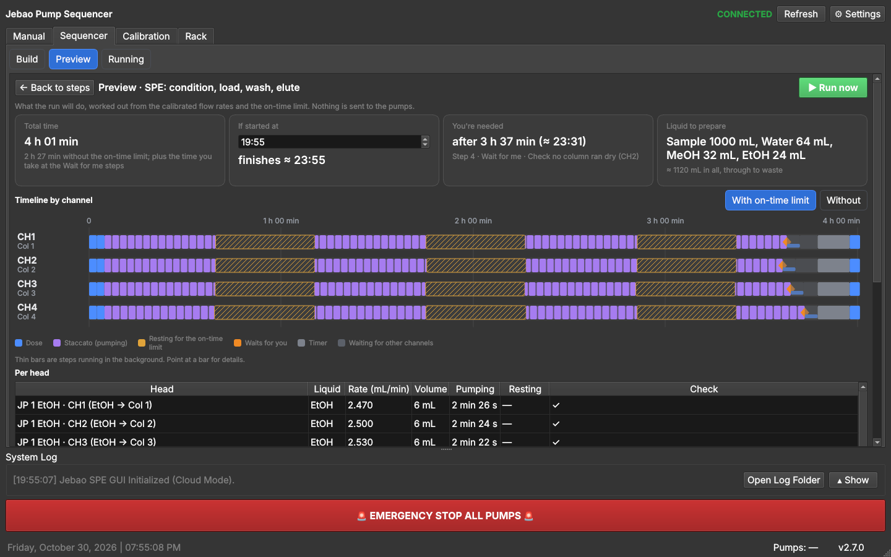
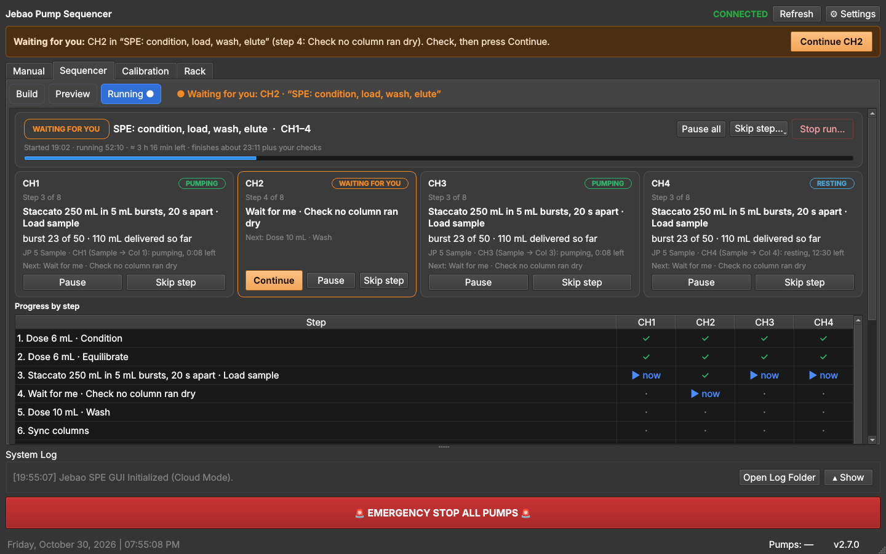

# Jebao Pump Sequencer

A desktop app for running Jebao MD-4.4 / Doser 2.4 four-channel dosing pumps from a computer: a live view of every pump head, dosing on many heads at once, calibration, multi-step sequences across several pumps, and one big emergency stop.



## Why

Jebao dosing pumps are cheap and reliable, but their phone app is built for aquariums: one pump at a time, a few doses a day. In the lab we use several of them to push solvents and samples through solid-phase extraction (SPE) cartridges, which needs exact volumes, steps in order, pauses for a person to check things, and a way to stop everything at once. This app does that on Windows and macOS.

## Features

- **Manual tab, the whole rack at a glance**: every pump appears where it sits on the bench, with its four heads as tiles showing the head's name, flow rate and what it's doing (idle, running with time left, paused, offline, not calibrated yet). Tile size S / M / L fits small and large screens.
- **Dose many heads at once**: click heads (or **All 4** on a pump) to select them, then dispense a volume (mL) or run them for a time (s). Each head runs for its own calibrated time; all start together. Pause, resume or cancel the selected heads.
- **Rack tab, your physical setup**: choose how many stacks and pumps per stack, drag pumps into place (or **Auto-arrange A→Z**: JP 2 comes before JP 10), and give each pump and head a name, like "Water → Col 3". Each pump's name in the Jebao app stays visible next to yours, so you can tell which pump is which. Other people can set up their own rigs the same way.
- **Automatic calibration with a balance**: pick the heads on the rack, put their outlets in one beaker on a Mettler Toledo or Bonvoisin balance, and press Calibrate. The heads run one after another; for each, the app fits a straight line to the mass readings and saves its slope as the flow rate when the line fits well (R² ≥ 0.99) and the flow was steady (the first and second half agree within 2 %; both adjustable). It also shows how late each pump really started and stopped after the app sent ON and OFF. Heads that don't pass are redone, then left for you to Accept or Redo. Every run is saved as a CSV, with the raw readings.
- **Manual calibration**: or run the selected heads for a set time (60 s by default), type in the volume or mass each one delivered, and save.
- **Sequences, built as cards**: add steps (Dose, Staccato, Wait (timer), Wait for me, Sync columns, Run sequence), drag them into order, and set each one on the right: pick heads by name from the rack (from any pumps), an amount by volume or time, bursts for Staccato, or run it in the background. Each card says what the step does and how long it takes. Undo, copy and paste, and keyboard shortcuts work as you'd expect.
- **Before you run**: the app checks for missing heads, old or missing calibrations, offline pumps, two heads pumping into the same channel at once, rests for the on-time limit and missing sub-sequences, and adds up the liquid you need. **Checks…** sets, for each sequence, how strict to be: two heads in one channel stop the run, warn or are allowed; offline pumps warn or ask before running; and how old a calibration may be.
- **Preview**: the total time (with and without the on-time limit), when it will finish, when you'll be needed, the liquid to prepare, a timeline per channel and a table per head. Nothing is sent to the pumps.
- **Channels run side by side**: each channel works through the steps on its own heads at the same time as the others, and **Sync columns** lines them up again. Channels are numbered by stack: CH1–4 in Stack A, CH5–8 in Stack B and so on, so two stacks give eight channels.
- **Running view**: progress, time left and the finish time; a card per channel with its current step, bursts and mL delivered; pause or skip one channel or all; stop the run. Every run is kept in a run history, including where a stopped run had got to.
- **Saved sequences and the queue**: search, duplicate, rename, export and import sequences; line several up and they run one after another. Reorder the queue or pause it after the current run.
- **Wait for me steps you can't miss**: an orange bar appears across the top naming the step, with a Continue button for each waiting channel, and the app can play a sound. Give the step a message, such as a setup change to make there, and it shows in the bar when the run gets there.
- **Discord notifications**: the app can post to a channel on your Discord server when a channel waits for you (with the step's message), when a run fails, stops or finishes, when a head can't be confirmed OFF, when a pump goes offline mid-run and when a head rests. Choose which ones ping your phone. Discord only receives messages; it can't control the pumps. See [Discord notifications](#discord-notifications).
- **Pump guard: no head left running, none running too long**
  - **OFF until it works.** Every OFF is retried until it gets through. An OFF to a pump that has dropped off Wi-Fi only counts once that pump reports the head off.
  - **Checks what the pumps report.** Every 30 s the app reads each pump's own report of its four heads. A head running that the app didn't start (a lost OFF, a pump that reconnected, the phone app, or left over from before the app opened) is turned off and logged.
  - **On-time limit.** Each head may run at most **30 min in any 60 min** by default (Settings → Pump safety). Each head can have its own limit or none (Rack tab); a head's own limit applies even when the default is turned off. A dose that reaches the limit turns the head off to rest, then carries on, so the full volume still goes in, just later.
  - **One head at a time per channel.** Two heads pumping into the same channel (the same CH number, e.g. JP 1 · CH1 and JP 2 · CH1 into column 1) are refused in the Manual tab (Settings → Pump safety), and stop a sequence unless its Checks allow it.
  - **Red bar.** While a head isn't confirmed off, a red bar says so, and the app won't close or update without asking.
- **Pump Wi-Fi watch**: every 30 s the app checks which pumps are online. The tiles and the "Pumps: 9/10 online" count in the bottom-right corner follow along, and each drop and reconnection goes in the System Log. Click the count (or **Settings → Pump Connections**) for a report: drops per pump in the last day and week, time offline, the longest outage, when each pump was last seen, its MAC address (for router address reservations), how quickly the cloud answers, and tips for the router's settings. The history is kept on each computer, in the log folder.
- **Emergency stop**: one button cancels the running sequence and any manual doses, clears the queue and turns off all four channels on every pump.
- **System log under every tab**: everything the app does is logged and saved on each computer for 30 days (adjustable in Settings). When you open the app, recent history is shown again above the new session. **Hide** shrinks it to one line showing the latest message.
- **Shared settings**: keep your login, calibrations, layout, names and sequences in a synced folder so every computer uses the same ones.
- **Version and updates**: the version is shown in the bottom-right corner. When a newer release is out it turns orange ("Update available"); click it to see what changed and update. It won't update while a sequence, dose or calibration is running.
- **One copy at a time**: opening the app again brings the open window to the front, so two copies never drive the same pumps.
- **Window layout**: on each computer the window opens where you left it, at the same size, with the dividers where you put them.
- **Desktop shortcut**: the app puts an icon on your desktop the first time it starts and refreshes it after each update. On Windows it opens without a console window; on a Mac it's a small app you can drag to the Dock. You can turn this off in Settings.











## Requirements

- Python 3.11 or newer
- Windows 10/11 or macOS (Linux works for development)
- Pumps already connected to Wi-Fi and added to a Jebao account in the **Jebao Aqua** phone app
- An internet connection: the app controls the pumps through the Jebao cloud, not over your local network
- For automatic calibration (optional): a balance with a serial or USB connection. Mettler Toledo balances (MT-SICS) work as they are; Bonvoisin and similar balances need continuous output turned on. Both at 9600 baud, reading in grams.

## Install

**Easiest:** get the code (step 1), then double-click `Launch_Windows.bat` (Windows) or `Launch_Mac.command` (macOS). The first time, it creates the `.venv` folder and installs everything the app needs (a minute or two), then starts the app. If the app ever stops starting, double-click `Setup_Windows.bat` or `Setup_Mac.command` to repair or reinstall the packages. The manual steps follow.

1. Get the code:
   ```
   git clone https://github.com/brandonbtm29/Jebao-Pump-Sequencer.git
   cd Jebao-Pump-Sequencer
   ```
2. Create a virtual environment and install the app.

   **Windows** (PowerShell or Command Prompt):
   ```
   python -m venv .venv
   .venv\Scripts\pip install -e .
   ```
   **macOS**:
   ```
   python3 -m venv .venv
   .venv/bin/pip install -e .
   ```
3. Start it: double-click `Launch_Windows.bat` or `Launch_Mac.command`. The launcher's console or Terminal window closes once the app starts (it stays open with a message if something is missing). You can also run `python jebao_gui.py`, or the `jebao-pump` command that the install adds to the virtual environment.
4. The first time the app starts it puts a **Jebao Pump Sequencer** icon on your desktop. Use that from then on.

## First run

1. Click **Settings** and enter the email and password of your Jebao account. Choose a theme and text size if you like.
2. The app logs in and shows your pumps in the **Manual** tab, using the names you gave them in the phone app. At first they are all in one stack.
3. Open the **Rack** tab and arrange them as they sit on your bench: set the number of stacks and pumps per stack, then drag each pump into its place (or press **Auto-arrange A→Z**). Click a pump to name it and its heads.
4. Calibrate each head you plan to use (**Calibration** tab: **Uncalibrated** selects the ones that still need it). Until you do, the app assumes 1 mL/min and marks the head "not calibrated", so volume doses would be wrong.
5. In **Manual**, select a head, try a small dose, then build a sequence in **Sequencer**: add steps with the buttons under the list, pick the heads on the right, check **Preview**, then press **▶ Run now**.

Coming from 1.x? Your login, calibrations, pump order and saved sequences carry over. The pumps start in one stack in your old order until you arrange them in the Rack tab.

## Updating

Each time it starts, the app asks GitHub for the latest release (a normal web request; nothing about you or your pumps is sent). To turn that off, untick **Check for updates when the app starts** in **Settings → App**. If a newer one is out, the version in the bottom-right corner turns orange; nothing pops up. Click it, or open **Settings** and press **Check for Updates**, to read what changed and choose **Update and Restart**. The app:

- only moves to published releases, never to unfinished work;
- refuses if you changed any of the app's own files, so nothing of yours is overwritten;
- reinstalls the dependencies only when the release changed them, and goes back to the old version if that fails;
- won't update while a sequence is running or queued, or a dose or calibration is in progress. Restarting mid-dose could leave a pump running;
- refreshes the desktop shortcut after the restart, so its icon and target match the new version.

This needs a copy made with `git clone` and Git installed. A ZIP download can't update itself; the app links to the release page instead. You can also update by hand with `git pull` and `pip install -e .`.

## Discord notifications

1. In Discord, make a channel for the lab (a private one is best), then open **Server Settings → Integrations → Webhooks → New Webhook**. Pick that channel and press **Copy Webhook URL**.
2. In the app, open **Settings → Discord → Notifications…**, tick **Send notifications to Discord** and paste the URL.
3. To be pinged on your phone, paste your Discord user ID under **Ping**. To find it, turn on **User Settings → Advanced → Developer Mode** in Discord, then right-click your name and choose **Copy User ID**.
4. Choose which events to send and which ones ping you, then press **Send a test message**.

Anyone who has the webhook URL can post in that channel, so treat it like a password. If it leaks, delete the webhook in Discord and make a new one. The app keeps it in `secrets.json`.

## Configuration

The app keeps two settings files:

| File | What's in it | Example |
|---|---|---|
| `secrets.json` | Your Jebao login and, if you use it, the Discord webhook URL | [`examples/secrets.example.json`](examples/secrets.example.json) |
| `jebao_config.json` | Theme, whether to check for updates at start (`check_updates_on_start`), the rack layout, pump and head names, calibrations and their dates, automatic-calibration settings (balance, port, volume, limits), the on-time limit and the Manual tab's one head per channel (`guard`), per-head limits (`pumps.<id>.limits`), Discord notifications (`discord`: on or off, events, pings, the ID to ping), Manual tab choices (tile size, last amount), the current sequence and saved sequences, and each one's checks (`sequence_checks`, `saved_sequence_checks`) | [`examples/jebao_config.example.json`](examples/jebao_config.example.json) |

You don't need to write either file yourself. The app creates them when you save settings.

- **Where they live:** by default in the app folder. Both are listed in `.gitignore`, so they never get committed. **Settings → Settings Folder** can move them. A folder inside a synced drive (SyncThing, OneDrive…) shares them between computers. The choice is stored in `settings_location.json`, and the `UAKRON_SETTINGS_DIR` environment variable overrides it.
- **Window size and position** are kept per computer in `window_state.json` in the app folder (also gitignored). It never moves to the settings folder, because each computer has its own screens.
- **Data folder:** the app runs inside `~/SyncThing/UAkron Playground/Jebao Pump`. Set `UAKRON_APP_DATA_DIR` to use a different folder; the app creates it if it is missing. Its `logs/` folder holds two kinds of log:
  - the **system log** you see in the window, one file per day per computer (`events-YYYY-MM-DD-<computer>.log`), kept for 30 days by default. **Open Log Folder** in the log box opens it.
  - the **error log**, `jebao_pump_sequencer.log`, with tracebacks of errors. An unexpected error is shown in a dialog instead of closing the app. **Settings → App → Open Log Folder** opens this folder too.

  Its `calibrations/` folder keeps a CSV of every automatic calibration (`autocal-<date-time>.csv`, one row per try) and the raw balance readings next to it (`…_raw.csv`).

## Troubleshooting

- **The app doesn't start:** double-click the launcher again. If its window shows an error, double-click `Setup_Windows.bat` or `Setup_Mac.command` to repair the install, then try again.
- **Nothing seems to happen when you open it:** it's probably open already, minimized or on another desktop. Only one copy runs at a time; opening it again brings the open window to the front.
- **Reporting a problem:** press **Settings → App → Copy Diagnostics** and paste the text into a GitHub issue or an email. It has the version, this computer's setup and the end of the error log, without your login, pump IDs or MAC addresses.

## How it works

```
 Jebao Pump Sequencer ──HTTPS──▶ Gizwits cloud (usapi.gizwits.com) ──▶ pumps on Wi-Fi
```

Once a Jebao pump is on Wi-Fi it only takes commands from the cloud service behind the Jebao app (Gizwits). The app logs in with your account, lists the pumps bound to it, and turns channels on and off with commands like `{"attrs": {"channe1": true}}`. "channe" is the API's own spelling.

A dose of *V* mL turns the channel on, waits *V ÷ flow rate* minutes, then turns it off. Flow rates come from calibration.

Automatic calibration runs each head until about the chosen volume has reached the balance. Before and after, it waits until the reading is still. The **flow rate** is the slope of a straight line through the readings while the pump runs, leaving out the first and last few seconds of the flow; that is the rate saved. Where the line meets the mass before and after the run shows when the pump really started and stopped, so the app can report the **start and stop delays**: how long the cloud took to pass ON and OFF to the pump. Those delays change from one command to the next (from about a second to 20 s in testing), which is why they aren't built into the rate: they are the main limit on how accurately a timed dose can be delivered, especially a short one. Network calls run in the background (PyQt6 with an asyncio loop through `qasync`), so the window stays responsive.

## Limitations

- **Accuracy depends on calibration and the network.** Doses are timed on/off commands, so a slow cloud round trip makes a dose slightly longer or shorter. Recalibrate when you change tubing.
- **If the app or the internet stops mid-dose, the pump can keep running**, because the off command never arrives. Stop it with the pump's own button or the phone app.
- **No local control.** If the Jebao cloud is down, the app can't reach the pumps.
- **Adding new pumps to Wi-Fi** still needs the phone app. See [`docs/provisioning-research.md`](docs/provisioning-research.md) for the plan to automate it.
- Changes and fixes for each version are listed in the [CHANGELOG](CHANGELOG.md).

## Development

```
pip install -e ".[dev]"
ruff check .
ruff format --check .
pytest
```
The tests run headless (`QT_QPA_PLATFORM=offscreen` is set for you) and never touch the network or your real settings. CI runs the same checks on Ubuntu and Windows with Python 3.11–3.13, plus a secret scan of the whole history.

The version number lives in one place, `__version__` in `jebao_gui.py`. To make a release, bump it, move the "Unreleased" notes in `CHANGELOG.md` under the new version, then tag `vX.Y.Z` and create a GitHub release from those notes.

`settings_location.py` is shared, unchanged, by several of my lab apps, so ruff leaves it alone. `crash_log.py`, `diagnostics.py` and `single_instance.py` are shared the same way: change them in every app at once, or not at all.

The icon in `assets/` is drawn by `scripts/make_icon.py` (needs `pip install pillow`); run it again after changing the design.

## How this was built

Jebao Pump Sequencer is written and maintained by Brandon T. McReynolds with the help of AI coding assistants. Versions before October 2026 were co-developed with Google Gemini in Antigravity. Later versions were co-developed with Claude (Anthropic), and those commits list Claude as a co-author. Brandon directs the work, reviews and tests the changes, and is responsible for the project.

Not affiliated with Jebao or Gizwits.

## License

MIT. See [LICENSE](LICENSE).
