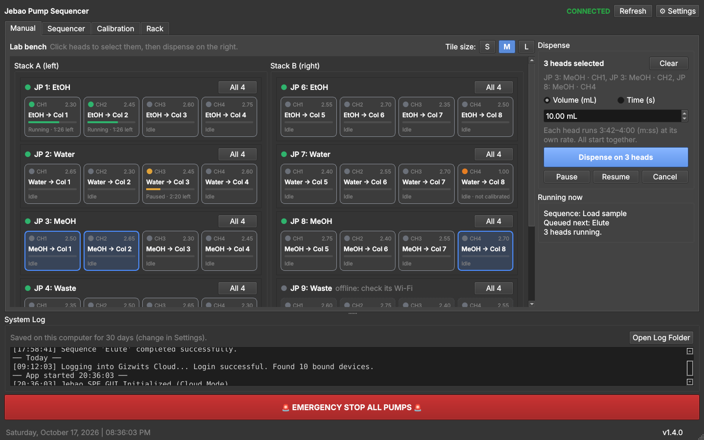
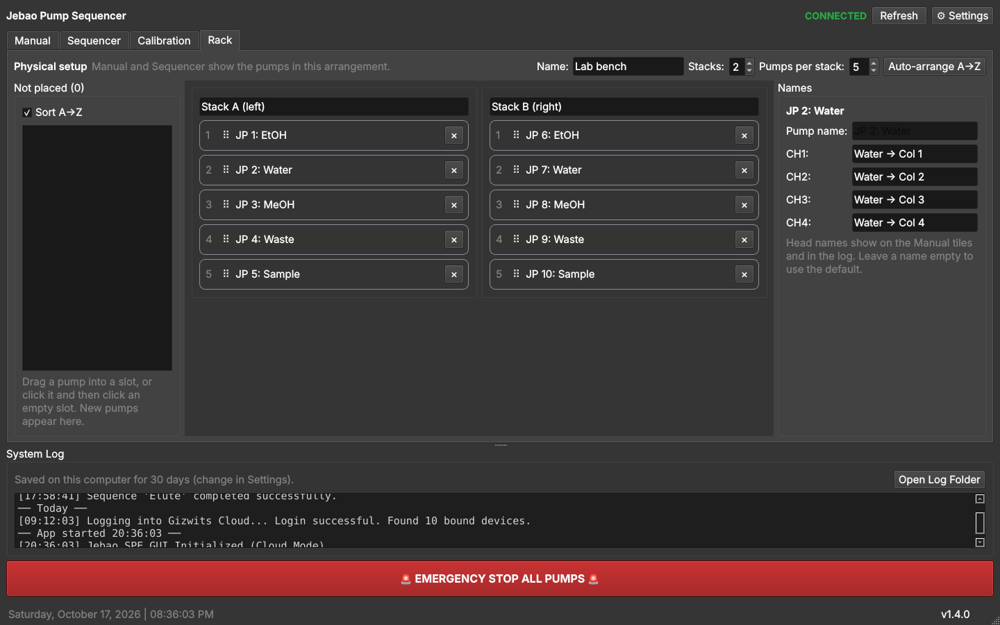
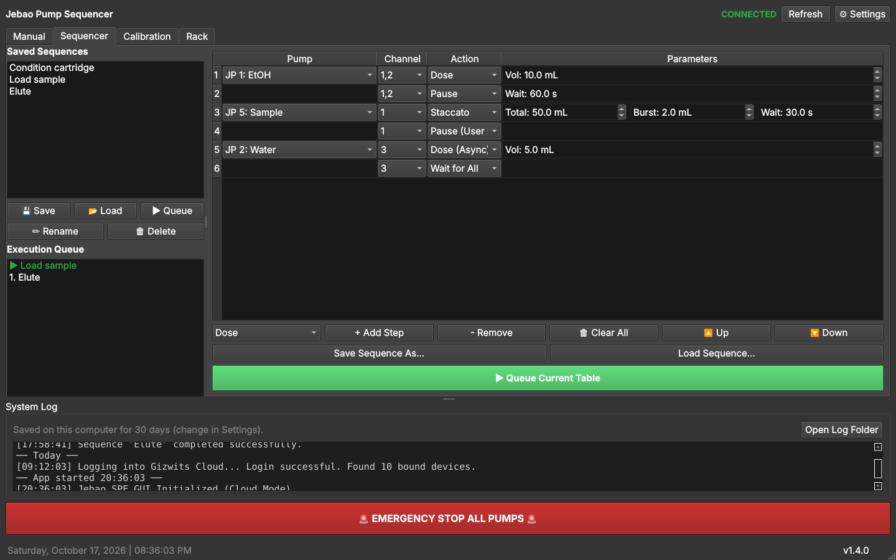

# Jebao Pump Sequencer

A desktop app for running Jebao MD-4.4 / Doser 2.4 four-channel dosing pumps from a computer: a live view of every pump head, dosing on many heads at once, calibration, multi-step sequences across several pumps, and one big emergency stop.



## Why

Jebao dosing pumps are cheap and reliable, but their phone app is built for aquariums: one pump at a time, a few doses a day. In the lab we use several of them to push solvents and samples through solid-phase extraction (SPE) cartridges, which needs exact volumes, steps in order, pauses for a person to check things, and a way to stop everything at once. This app does that on Windows and macOS.

## Features

- **Manual tab, the whole rack at a glance**: every pump appears where it sits on the bench, with its four heads as tiles showing the head's name, flow rate and what it's doing (idle, running with time left, paused, offline, not calibrated yet). Tile size S / M / L fits small and large screens.
- **Dose many heads at once**: click heads (or **All 4** on a pump) to select them, then dispense a volume (mL) or run them for a time (s). Each head runs for its own calibrated time; all start together. Pause, resume or cancel the selected heads.
- **Rack tab, your physical setup**: choose how many stacks and pumps per stack, drag pumps into place (or **Auto-arrange A→Z**: JP 2 comes before JP 10), and give each pump and head a name, like "Water → Col 3". Other people can set up their own rigs the same way.
- **Calibration**: run a channel for 60 seconds, type in the volume or mass you collected (water, ethanol, methanol or a custom density), and the app saves that channel's flow rate, the tubing size and the date.
- **Sequences**: build a table of steps (Dose, Staccato, Pause, Pause for user review, Wait for all, Run sub-sequence) across any of your pumps, save it under a name, and reuse it. Saved sequences and the queue are in the Sequencer tab.
- **Channels run side by side**: each channel works through its own steps at the same time as the others. "Wait for All" lines them up again, and async doses run in the background.
- **Queue**: line up several saved sequences and they run one after another.
- **Review steps you can't miss**: when a sequence waits for your review, an orange bar appears across the top with an Approve button for each waiting channel.
- **Emergency stop**: one button cancels the running sequence and any manual doses, clears the queue and turns off all four channels on every pump.
- **System log under every tab**: everything the app does is logged and saved on each computer for 30 days (adjustable in Settings). When you open the app, recent history is shown again above the new session.
- **Shared settings**: keep your login, calibrations, layout, names and sequences in a synced folder so every computer uses the same ones.
- **Version and updates**: the version is shown in the bottom-right corner. When a newer release is out it turns orange ("Update available"); click it to see what changed and update. It won't update while a sequence, dose or calibration is running.
- **Desktop shortcut**: the app puts an icon on your desktop the first time it starts and refreshes it after each update. On Windows it opens without a console window; on a Mac it's a small app you can drag to the Dock. You can turn this off in Settings.





## Requirements

- Python 3.11 or newer
- Windows 10/11 or macOS (Linux works for development)
- Pumps already connected to Wi-Fi and added to a Jebao account in the **Jebao Aqua** phone app
- An internet connection: the app controls the pumps through the Jebao cloud, not over your local network

## Install

**Easiest:** double-click `Setup_Windows.bat` (Windows) or `Setup_Mac.command` (macOS) once. It creates the `.venv` folder and installs everything the app needs; run it again any time to repair or update the packages. The manual steps follow.

1. Get the code:
   ```
   git clone https://github.com/brandonbtm29/Jebao-Pump-Sequencer.git
   cd Jebao-Pump-Sequencer
   ```
2. Create a virtual environment and install the app.

   **Windows** (PowerShell or Command Prompt):
   ```
   python -m venv .venv
   .venv\Scripts\pip install -e .
   ```
   **macOS**:
   ```
   python3 -m venv .venv
   .venv/bin/pip install -e .
   ```
3. Start it: double-click `Launch_Windows.bat` or `Launch_Mac.command`. The launcher's console or Terminal window closes once the app starts (it stays open with a message if something is missing). You can also run `python jebao_gui.py`, or the `jebao-pump` command that the install adds to the virtual environment.
4. The first time the app starts it puts a **Jebao Pump Sequencer** icon on your desktop. Use that from then on.

## First run

1. Click **Settings** and enter the email and password of your Jebao account. Choose a theme and text size if you like.
2. The app logs in and shows your pumps in the **Manual** tab, using the names you gave them in the phone app. At first they are all in one stack.
3. Open the **Rack** tab and arrange them as they sit on your bench: set the number of stacks and pumps per stack, then drag each pump into its place (or press **Auto-arrange A→Z**). Click a pump to name it and its heads.
4. Calibrate each head you plan to use (**Calibration** tab). Until you do, the app assumes 1 mL/min and marks the head "not calibrated", so volume doses would be wrong.
5. In **Manual**, select a head, try a small dose, then build a sequence in **Sequencer**.

Coming from 1.x? Your login, calibrations, pump order and saved sequences carry over. The pumps start in one stack in your old order until you arrange them in the Rack tab.

## Updating

Each time it starts, the app asks GitHub for the latest release (a normal web request; nothing about you or your pumps is sent). If a newer one is out, the version in the bottom-right corner turns orange. Click it, or open **Settings** and press **Check for Updates**, to read what changed and choose **Update and Restart**. The app:

- only moves to published releases, never to unfinished work;
- refuses if you changed any of the app's own files, so nothing of yours is overwritten;
- reinstalls the dependencies only when the release changed them, and goes back to the old version if that fails;
- won't update while a sequence is running or queued, or a dose or calibration is in progress. Restarting mid-dose could leave a pump running;
- refreshes the desktop shortcut after the restart, so its icon and target match the new version.

This needs a copy made with `git clone` and Git installed. A ZIP download can't update itself; the app links to the release page instead. You can also update by hand with `git pull` and `pip install -e .`.

## Configuration

The app keeps two settings files:

| File | What's in it | Example |
|---|---|---|
| `secrets.json` | Your Jebao login | [`examples/secrets.example.json`](examples/secrets.example.json) |
| `jebao_config.json` | Theme, the rack layout, pump and head names, calibrations and their dates, tubing sizes, Manual tab choices (tile size, last amount), the current sequence and saved sequences | [`examples/jebao_config.example.json`](examples/jebao_config.example.json) |

You don't need to write either file yourself. The app creates them when you save settings.

- **Where they live:** by default in the app folder. Both are listed in `.gitignore`, so they never get committed. **Settings → Settings Folder** can move them. A folder inside a synced drive (SyncThing, OneDrive…) shares them between computers. The choice is stored in `settings_location.json`, and the `UAKRON_SETTINGS_DIR` environment variable overrides it.
- **Data folder:** the app runs inside `~/SyncThing/UAkron Playground/Jebao Pump`. Set `UAKRON_APP_DATA_DIR` to use a different folder; the app creates it if it is missing. Its `logs/` folder holds two kinds of log:
  - the **system log** you see in the window, one file per day per computer (`events-YYYY-MM-DD-<computer>.log`), kept for 30 days by default. **Open Log Folder** in the log box opens it.
  - the **error log**, `jebao_pump_sequencer.log`, with tracebacks of errors. An unexpected error is shown in a dialog instead of closing the app.

## How it works

```
 Jebao Pump Sequencer ──HTTPS──▶ Gizwits cloud (usapi.gizwits.com) ──▶ pumps on Wi-Fi
```

Once a Jebao pump is on Wi-Fi it only takes commands from the cloud service behind the Jebao app (Gizwits). The app logs in with your account, lists the pumps bound to it, and turns channels on and off with commands like `{"attrs": {"channe1": true}}`. "channe" is the API's own spelling.

A dose of *V* mL turns the channel on, waits *V ÷ flow rate* minutes, then turns it off. Flow rates come from calibration. Network calls run in the background (PyQt6 with an asyncio loop through `qasync`), so the window stays responsive.

## Limitations

- **Accuracy depends on calibration and the network.** Doses are timed on/off commands, so a slow cloud round trip makes a dose slightly longer or shorter. Recalibrate when you change tubing.
- **If the app or the internet stops mid-dose, the pump can keep running**, because the off command never arrives. Stop it with the pump's own button or the phone app.
- **No local control.** If the Jebao cloud is down, the app can't reach the pumps.
- **Adding new pumps to Wi-Fi** still needs the phone app. See [`docs/provisioning-research.md`](docs/provisioning-research.md) for the plan to automate it.
- Changes and fixes for each version are listed in the [CHANGELOG](CHANGELOG.md).

## Development

```
pip install -e ".[dev]"
ruff check .
ruff format --check .
pytest
```
The tests run headless (`QT_QPA_PLATFORM=offscreen` is set for you) and never touch the network or your real settings. CI runs the same checks on Ubuntu and Windows with Python 3.11–3.13, plus a secret scan of the whole history.

The version number lives in one place, `__version__` in `jebao_gui.py`. To make a release, bump it, move the "Unreleased" notes in `CHANGELOG.md` under the new version, then tag `vX.Y.Z` and create a GitHub release from those notes.

`settings_location.py` is shared, unchanged, by several of my lab apps, so ruff leaves it alone.

The icon in `assets/` is drawn by `scripts/make_icon.py` (needs `pip install pillow`); run it again after changing the design.

## How this was built

Jebao Pump Sequencer is written and maintained by Brandon T. McReynolds with the help of AI coding assistants. Versions before October 2026 were co-developed with Google Gemini in Antigravity. Later versions were co-developed with Claude (Anthropic), and those commits list Claude as a co-author. Brandon directs the work, reviews and tests the changes, and is responsible for the project.

Not affiliated with Jebao or Gizwits.

## License

MIT. See [LICENSE](LICENSE).
